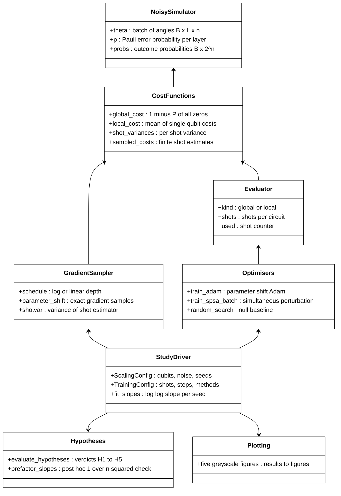
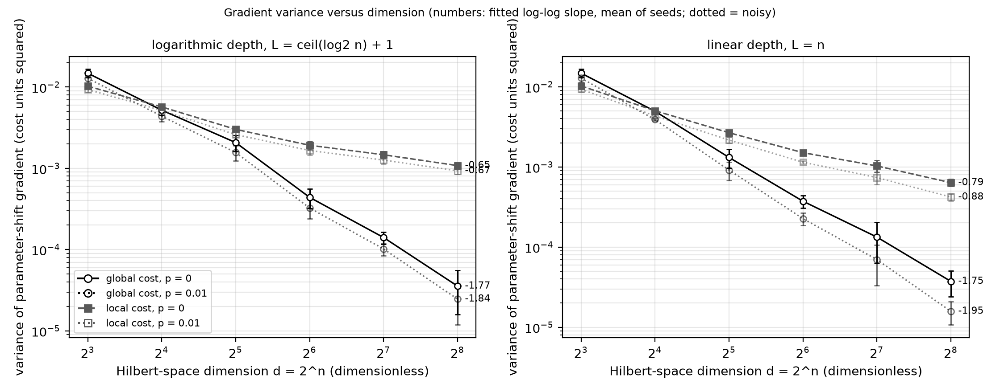
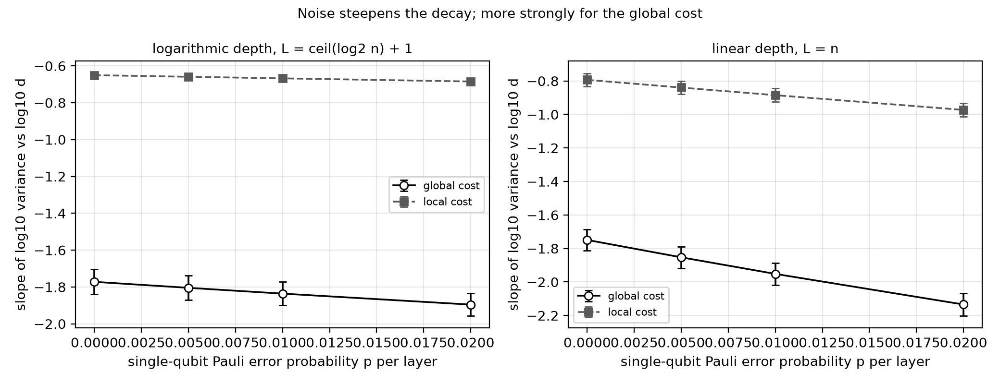
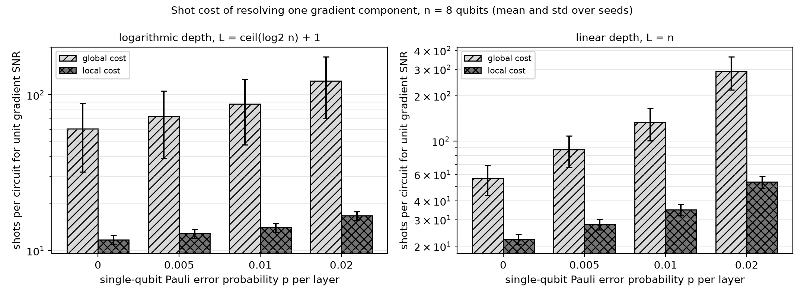
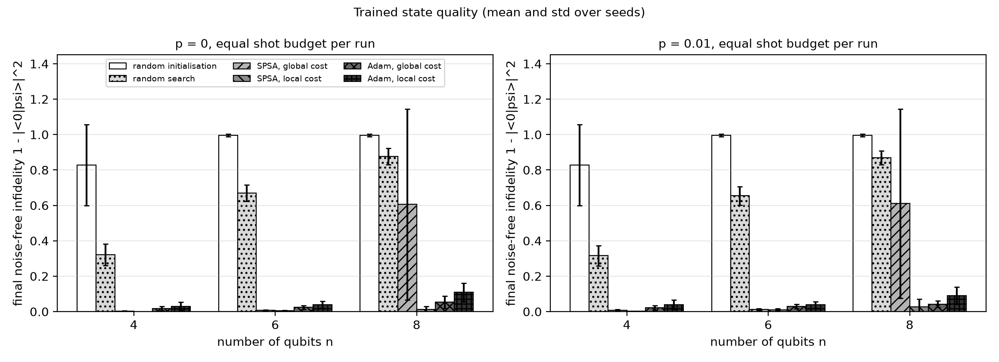
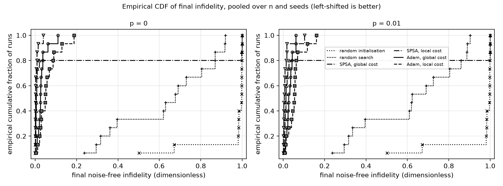

# Local versus Global Cost Functions under Hardware Noise: Barren-Plateau Gradient Scaling and Shot Cost in Exact Noisy Simulation


## Abstract

Variational quantum algorithms (VQAs) suffer from barren plateaus (BPs), and two separate results say
that a local cost removes the cost-dependent plateau while hardware noise creates a noise-induced
barren plateau (NIBP) regardless. This study measures, in exact density-matrix simulation of 3 to 8 qubits
with layer-wise depolarising noise, how the gradient variance and the shots needed to resolve a
gradient scale for global and local costs under logarithmic and linear circuit depth, and then trains
the circuit under an equal shot budget with Adam, simultaneous-perturbation stochastic approximation
(SPSA) and random search. The local cost keeps a clearly shallower variance decay at every noise level
tested, noise steepens the global-cost decay about twice as much as the local-cost decay at linear
depth, and the training benefit of locality appears for SPSA but not for Adam with parameter-shift
gradients, where the global cost trained better in this size range.

## Motivation

A barren plateau makes the number of measurement shots needed to find a descent direction grow
exponentially with qubit number (Larocca et al., 2025, doi:10.1038/s42254-025-00813-9). Practitioners
are told to use local cost functions (Cerezo et al., 2021, doi:10.1038/s41467-021-21728-w) and to keep
circuits shallow because noise alone produces vanishing gradients at linear depth (Wang et al., 2021,
doi:10.1038/s41467-021-27045-6). The Variational Quantum Eigensolver (VQE) review lists shot counts
and noise as open problems (Tilly et al., 2022, doi:10.1016/j.physrep.2022.08.003). The practical
question is quantitative: on a noisy device, does the local-cost advantage survive, and what does it
save in shots?

## Research gap

Both theorems are proven for their own mechanism and in asymptotic form. The related-work table, with
twelve papers from landmark, review and adjacent roles, is in `docs/RESEARCH_GAP.md`; none of them
(within the supplied literature set) reports a finite-size, noisy comparison of the two cost types in gradient variance, in shots, and in
equal-budget training. A weight-n Pauli expectation decays under single-qubit Pauli noise like
(1 - 4p/3)^(nL) and a weight-one expectation like (1 - 4p/3)^L, so noise could treat the two costs
differently even though the NIBP theorem covers both.

## What is new here

* Joint measurement of gradient-variance exponents and **unit signal-to-noise-ratio (SNR) shot cost**
  for global and local costs over depth schedule x noise level, with per-seed log-log fits.
* A post-hoc check that separates the 1/n^2 prefactor of a normalised local cost from the plateau
  itself (it explains most of the local-cost "decay" at these sizes).
* An equal-shot-budget training comparison against classical optimiser baselines (SPSA, random search)
  with the metric computed on the ideal state, so both costs are scored identically.
* Pre-stated hypotheses with explicit falsification thresholds; two of five are falsified below.

## Hypotheses

Stated in `docs/RESEARCH_GAP.md` before the final runs (hyper-parameter tuning used held-out seeds and
one pilot training run). Verdicts are in `results/hypotheses.json`.

| Id | Statement | Verdict |
|---|---|---|
| H1 | log depth, p = 0: global slope <= -0.7 and local slope >= -0.5 | **Falsified** (local slope -0.65) |
| H2 | log depth, p = 0.01: local minus global slope >= 0.4 | Supported (1.17 +/- 0.06) |
| H3 | linear depth: noise steepens global slope more than local by >= 0.1 | Supported (gap 0.21 +/- 0.01) |
| H4 | Adam with local cost beats Adam with global cost at n = 8, p = 0.01 (median) | **Falsified** (0.070 versus 0.038) |
| H5 | all trained methods beat random search (by mean) | Supported in all six settings |

## Method



Legend: VQA = variational quantum algorithm; SPSA = simultaneous-perturbation stochastic approximation;
B = batch size, L = number of layers, n = number of qubits.

**Circuit.** L layers on n qubits; each layer applies RY rotations (single-qubit rotation about the y
axis) on every qubit, controlled-Z (CZ) gates on even then odd nearest-neighbour bonds, then
single-qubit depolarising noise of Pauli error probability p on every qubit. The exact density matrix
is simulated as a batched real tensor in PyTorch (all gates are real).

**Costs.** From |0...0>: global C_G = 1 - P(0...0); local C_L = 1 - (1/n) sum_j P(qubit j = 0).

**Depth ablation.** Logarithmic depth L = ceil(log2 n) + 1 (the regime where a local cost is trainable
without noise) versus linear depth L = n (the regime where NIBPs are proven).

**Experiment 1.** n = 3 to 8, p in {0, 0.005, 0.01, 0.02}, 3 seeds x 256 random initialisations: exact
parameter-shift gradient variance, and the shots per circuit at which the shot-noise standard deviation
equals the root-mean-square gradient ("unit SNR shots"); log-log slopes against d = 2^n.

**Experiment 2.** n in {4, 6, 8}, logarithmic depth, p in {0, 0.01}, 5 seeds, 200 shots per circuit,
identical total shots per run (25 Adam steps). Metric: noise-free infidelity 1 - |<0|psi>|^2 of the
final parameters. Baselines: Adam on the global cost (the standard barren-plateau setting), SPSA and
random search (classical optimiser baselines), and the untrained initialisation. Full details:
`docs/METHOD.md`.

## Results

All numbers are mean +/- standard deviation over seeds and are read from `results/`. Everything is
exact noisy simulation on at most 8 qubits, not hardware data.

### Gradient variance (Experiment 1)

Slope of log10 variance against log10 d (`results/scaling_slopes_summary.csv`; 3 seeds):

| Depth | Cost | p = 0 | p = 0.01 | p = 0.02 |
|---|---|---|---|---|
| log | global | -1.77 +/- 0.07 | -1.84 +/- 0.06 | -1.90 +/- 0.06 |
| log | local | -0.65 +/- 0.01 | -0.67 +/- 0.01 | -0.69 +/- 0.01 |
| linear | global | -1.75 +/- 0.06 | -1.95 +/- 0.07 | -2.13 +/- 0.07 |
| linear | local | -0.79 +/- 0.04 | -0.89 +/- 0.04 | -0.97 +/- 0.04 |



*Figure 1. The local cost keeps a shallower variance decay than the global cost at both depths; dotted
lines (p = 0.01) lie below solid lines (p = 0).*



*Figure 2. Increasing noise steepens the slope, much more for the global cost at linear depth.*

**Post-hoc prefactor check** (`results/prefactor_check_summary.csv`). A normalised local cost carries
a 1/n^2 variance prefactor. Fitting n^2 x variance instead gives local slopes of -0.09 +/- 0.01
(log depth, p = 0) and -0.24 +/- 0.04 (linear depth, p = 0), so most of the -0.65 local slope is the
prefactor, which is why H1 failed at these sizes. With the prefactor removed the local slope at p =
0.02 is -0.13 +/- 0.01 (log) and -0.42 +/- 0.04 (linear).

### Shot cost

Shots per circuit for unit gradient SNR at n = 8 (`results/gradient_scaling.csv`):

| Depth | Cost | p = 0 | p = 0.01 | p = 0.02 |
|---|---|---|---|---|
| log | global | 60 +/- 28 | 87 +/- 39 | 123 +/- 53 |
| log | local | 11.8 +/- 0.8 | 14.0 +/- 0.9 | 16.7 +/- 1.1 |
| linear | global | 56 +/- 13 | 133 +/- 33 | 291 +/- 73 |
| linear | local | 22.3 +/- 1.7 | 34.9 +/- 2.9 | 53.3 +/- 4.8 |

The ratio of mean shot costs (global over local) at n = 8 is 5.1, 6.2, 7.4 for log depth and 2.5, 3.8,
5.5 for linear depth at p = 0, 0.01, 0.02; at n = 3 it is between 0.96 and 1.06, so the advantage is a
growing-size effect. Shot-cost slopes against d at p = 0 are 0.85 +/- 0.06 (global) and 0.41 +/- 0.00
(local) at log depth (`results/scaling_slopes_summary.csv`).



*Figure 3. Noise raises the global-cost shot requirement faster than the local-cost requirement,
especially at linear depth.*

### Training with an equal shot budget (Experiment 2)

Final noise-free infidelity (`results/training_summary.csv`; 5 seeds; lower is better):

| p | n | init | random search | SPSA global | SPSA local | Adam global | Adam local |
|---|---|---|---|---|---|---|---|
| 0.01 | 4 | 0.83 +/- 0.23 | 0.32 +/- 0.06 | 0.008 +/- 0.004 | 0.001 +/- 0.001 | 0.021 +/- 0.013 | 0.039 +/- 0.027 |
| 0.01 | 6 | 0.995 +/- 0.007 | 0.65 +/- 0.05 | 0.013 +/- 0.004 | 0.011 +/- 0.006 | 0.030 +/- 0.013 | 0.039 +/- 0.018 |
| 0.01 | 8 | 0.996 +/- 0.007 | 0.87 +/- 0.04 | 0.61 +/- 0.53 | 0.027 +/- 0.043 | 0.042 +/- 0.019 | 0.090 +/- 0.048 |
| 0 | 8 | 0.996 +/- 0.007 | 0.88 +/- 0.05 | 0.61 +/- 0.54 | 0.013 +/- 0.015 | 0.053 +/- 0.035 | 0.109 +/- 0.052 |

At n = 8, runs with final infidelity below 0.1 (`results/training_success_counts.csv`) at p = 0.01:
SPSA global 2 of 5, SPSA local 4 of 5, Adam global 5 of 5, Adam local 3 of 5, random search 0 of 5; at
p = 0: 2, 5, 4, 3 and 0 of 5.



*Figure 4. Every optimiser beats random search; the n = 8 SPSA global-cost bar is the only large
failure (three of five seeds stay at infidelity close to 1).*



*Figure 5. The empirical cumulative distribution function (ECDF) of the final infidelity shows the
trained methods packed near zero, with SPSA on the global cost carrying a heavy tail at 1.*

## Discussion

* **Locality helps in gradient size, and the shot saving grows with n** (H2, H3): at n = 8 the local
  cost needs 5.1 to 7.4 times fewer shots at log depth. The result is not visible at n = 3.
* **Noise is not cost-agnostic at finite size.** At linear depth the noise-induced slope change is
  -0.39 (global) versus -0.18 (local), as expected from weight-n versus weight-one Pauli decay. This
  is a measured finite-size effect in a layer-wise depolarising model and does not contradict the
  asymptotic NIBP theorem.
* **Negative result 1 (H1).** The local slope is not flat (-0.65) at n <= 8; the post-hoc check shows
  the 1/n^2 normalisation prefactor dominates it. This reading is a post-hoc explanation, not a
  pre-registered one.
* **Negative result 2 (H4).** With Adam and parameter-shift gradients the global cost trained better
  than the local cost at n = 8 (0.038 versus 0.070 median at p = 0.01). Possibly Adam's per-parameter
  normalisation is insensitive to gradient scale while the SNR stays above one at 200 shots; this
  mechanism was not tested here. SPSA, which estimates one direction from two evaluations, does show
  the locality benefit at n = 8.
* The size range is small: the global-cost shot requirement at n = 8 (60 to 291 shots) is still below
  the 200-shot budget in most settings, so the training study does not reach the regime where global
  training fails for every optimiser.

## Limitations

Exact simulation only (n <= 8); layer-wise single-qubit depolarising noise, no readout, coherent or
correlated error; real-gate ansatz (RY and CZ) and a single task (state preparation of |0...0>, a
favourable case for local costs); gradients sampled at random parameters, not along optimisation
paths; three seeds for scaling fits (seeds resample initialisations), five for training; SPSA and Adam
hyper-parameters were tuned on a small held-out set only. The 0.1 success threshold was chosen after
seeing the data.

## Future work

Replace the noise model by a calibrated gate-resolved model and run the same unit-SNR measurement on
a device with 20 or more qubits, where the shot cost grows by orders of magnitude; test energy costs
of local Hamiltonians instead of state preparation; test whether Adam's scale invariance explains H4
by sweeping the shot budget; use tensor-network or Pauli-propagation simulation to extend the fits
beyond n = 8.

## Related work by the author

* [adapt-vs-hea-noise-induced-barren-plateau-vqe](https://github.com/pradeepdegalaroyal/adapt-vs-hea-noise-induced-barren-plateau-vqe):
  ansatz choice (adaptive versus hardware-efficient) under noise-induced plateaus; this study instead
  varies the cost locality and measures shots.
* [shot-fair-damped-qng-vqe-benchmark](https://github.com/pradeepdegalaroyal/shot-fair-damped-qng-vqe-benchmark):
  optimiser comparison with every shot charged, the same accounting principle used here.

## Reproducibility

```bash
pip install -r requirements.txt && pip install -e .
python experiments/run_all.py            # full study, about 7 minutes on the hardware below
python experiments/run_all.py --quick    # smoke run (about 30 s on GPU, 16 s on CPU), temporary output
python experiments/evaluate.py           # re-derive verdicts and post-hoc check from results/*.csv
pytest -q                                # 13 fast tests
```

Full run: 403.7 s (53.0 s scaling, 340.3 s training; `results/run_meta.json`) on Windows 11, Python
3.11.9, PyTorch 2.11.0 (CUDA 12.8), NVIDIA RTX 5050 Laptop graphics processing unit (GPU, 8 GB);
the code falls back to the central processing unit (CPU). Continuous integration (CI) runs the tests and
the `--quick` run on ubuntu-latest.

## Project structure

```
src/cost_locality_bp/   circuit.py, noisy_sim.py, costs.py, gradients.py, training.py,
                        study.py, hypotheses.py, plotting.py
experiments/            run_all.py (one command), evaluate.py (verdicts from saved CSVs)
tests/                  simulator, gradient, optimiser and hypothesis tests
docs/                   RESEARCH_GAP.md, METHOD.md
results/                raw and summary tables, hypotheses.json, run_meta.json
figures/                fig1 to fig5 (200 dpi, greyscale)
```

## Citation

```bibtex
@software{degala_local_vs_global_cost_2026,
  author  = {Degala, Chenchupradeep},
  title   = {Local versus Global Cost Functions under Hardware Noise: Barren-Plateau Gradient Scaling and Shot Cost in Exact Noisy Simulation},
  year    = {2026},
  version = {1.0.0},
  url     = {https://github.com/pradeepdegalaroyal/local-vs-global-cost-noisy-barren-plateau-shots},
  license = {MIT}
}
```

MIT license (`LICENSE`). Machine-readable citation metadata: `CITATION.cff`.
